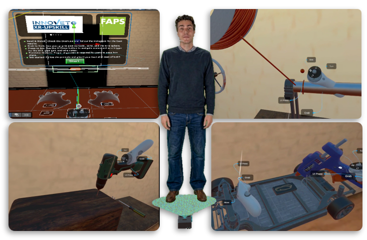
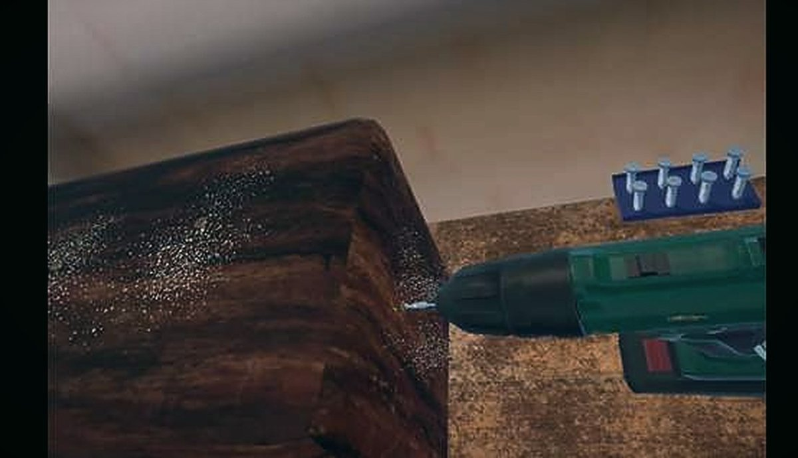
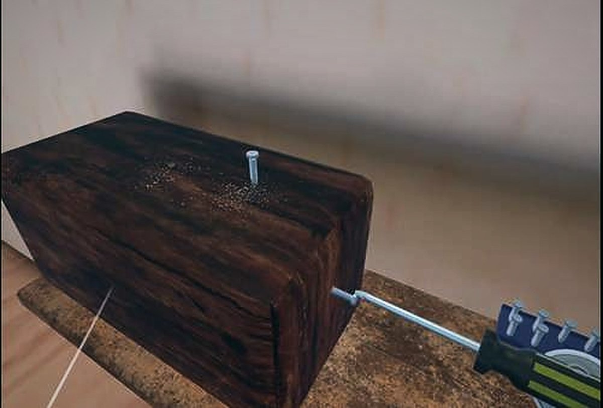
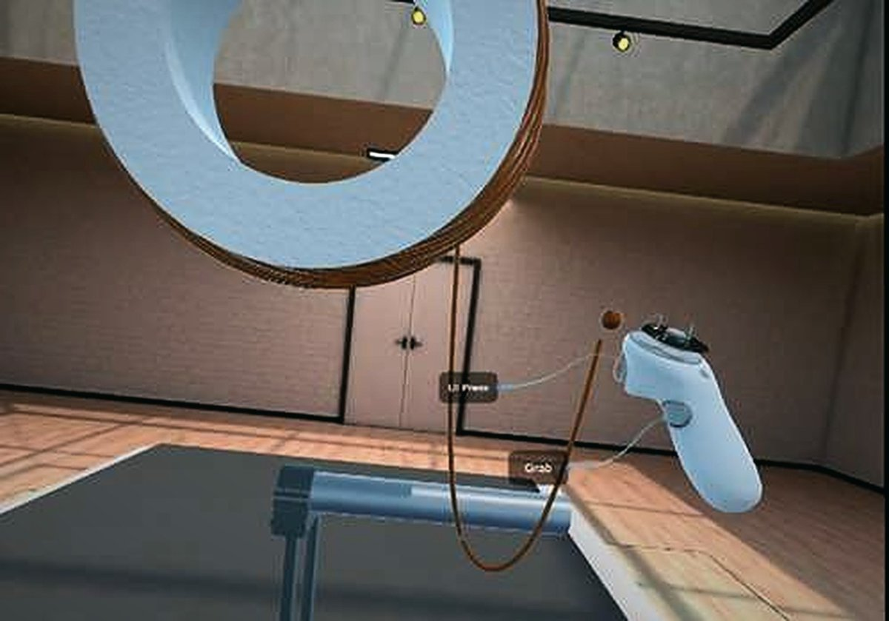
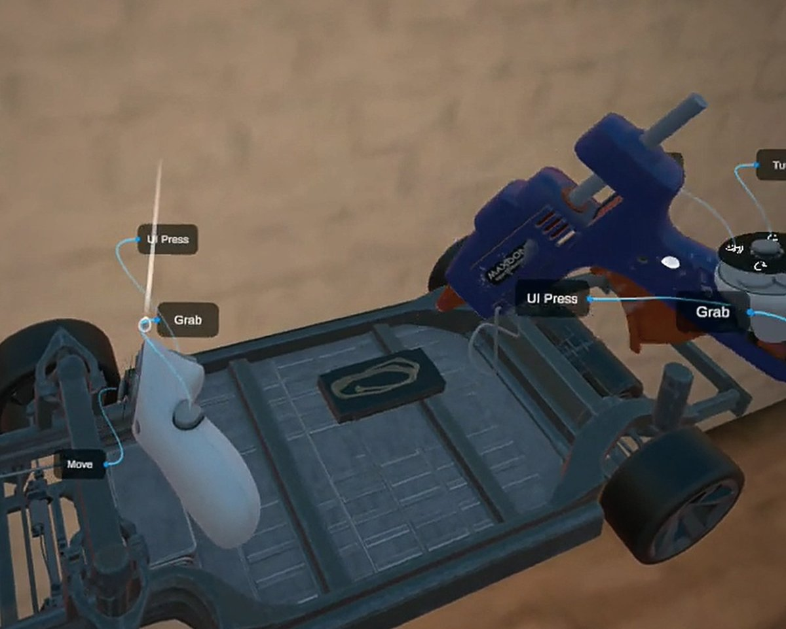
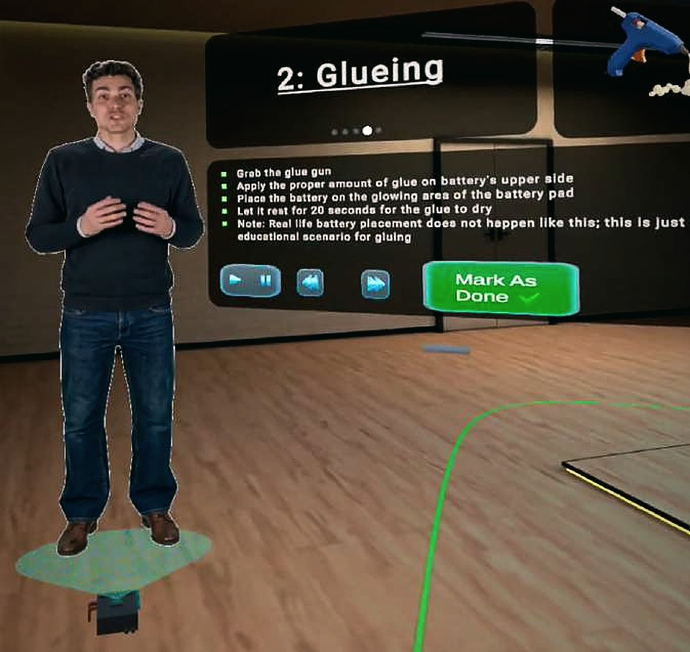

# 01 · Physics-Based VR Training Lab

**A VR lab where learners carry out real assembly tasks with their own hands: drilling, screwing, winding wire and gluing. Progress comes from what the learner physically does, not from objects snapping into place.**

Master's thesis *"Design and Development of an Immersive Virtual Laboratory for Autodidactic Learning of Powertrain Systems in Electromobility"*, FAU Erlangen-Nürnberg, Chair FAPS (2025–26), within the XR-UpSkill collaboration with Robert Bosch GmbH and the Virtual Dimension Center.

`Unity 6000.0` · `URP 17` · `XR Interaction Toolkit 3.0` · `OpenXR` · `XR Hands` · `Meta Quest 3` · about 7,900 lines of C# and 12 HLSL shaders

---

## ▸ TRAINING MODULES

### Drilling

- The drill only works on assigned surfaces, and only while its tip stays inside that surface's collider
- The hole deepens **in stages based on how far the drill has physically entered** the material, not on a timer
- Wood dust comes as a contact burst, a burst when the hole deepens and a continuous fountain, plus a dust decal on the surface
- Holes keep the same size in world space whatever the parent scale
- Haptics get stronger with depth, with separate audio for drilling in air and in wood
- A screw socket is only created once the hole is fully drilled

`SuperDrilling.cs` · shader `DrillHole.shader`
 

### Screwing

- A screw only seats when its tip is at the hole entry **and** its shaft is aligned with the hole axis
- The screwdriver's rotation **around the hole axis** is extracted and turned into travel through the thread pitch (turns × pitch = depth)
- The screw rotates and moves only along the hole axis, so it can't wobble
- A ratchet-style direction lock ignores small backward twists when the learner re-grips, and reverses only when they deliberately turn the other way
- Haptic clicks scale with twist speed

`Screw.cs` · `ScrewSocket.cs` · `ScrewdriverTwistDriver.cs`
 

### Wire winding and cutting

- The wire is a **custom Verlet rope** (gravity, damping, iterative distance constraints) rendered as a tube mesh
- Near the post, the rope switches to a **helix capture**: the learner's hand orbiting the post adds turns, mapped to arc length so the wire is used up realistically
- Winding direction is enforced, with start and release thresholds so accidental movements don't count
- The reel has **inertia and friction**, spins as wire is pulled off, and sends vibration that scales with its speed
- The cutter **splits the rope**: the cut tail becomes its own physics object and falls away

`VRCoilWithRopeMesh.cs` · `WireReelFeederRealistic.cs` · `WireRootOnReel.cs` · `WireAnchorFollower.cs` · `OneShotWireCutter.cs` · `RuntimeGrabPointDebug.cs`
 

### Gluing and placement

- The glue gun extrudes a **procedural bead mesh** along the surface. It's thicker when you move slowly, lags behind like a viscous liquid, sags slightly over time and has rounded ends
- The bead **dries over 20 s** through a shader blend from wet (glossy, translucent) to dry (matte, opaque)
- Each battery cell counts how much glue was actually deposited on it
- The placement grid checks **enough glue** and **glued side facing down**, and shows *missing glue*, *wrong orientation* and *ready* as separate colour states, with soft haptic pulses when the placement is correct
- Once the glue has dried, the cell locks in place; the next cell appears with a reveal effect

`GlueGunMeshExtruder_Final.cs` · `GlueStrandMesh_Final.cs` · `BatteryGlueState.cs` · `PlacementGridManager.cs` · `BatteryCellTrigger.cs` · `BatteryGrabKeeper.cs` · `SequentialBatteryPoolSpawner.cs`
 

### Mechanisms
- A handwheel limited to one axis (±540°) and smoothed, kept fixed in place while grabbed, that drives a lift through `WheelLift`

`SteeringWheelZDial.cs` · `WheelLift.cs`

---

## ▸ GUIDANCE SYSTEM

- **Holographic instructor.** A presenter video is keyed onto a quad above a holopad (green-screen and white-screen key shaders) with an animated dot-pattern projection cone underneath
- **Zone-triggered content.** Walking into a station area loads that station's video, steps and panels; the learner controls play/pause, forward/back and *Mark as Done*
- **Floor path.** A procedurally generated ribbon mesh leads to the next station; finished sections fade out as the learner progresses
- **Session flow.** A start sequence places the headset exactly at the spawn point; an end panel lets the learner keep exploring or exit; objects can be reset to their starting state
- **Pressable VR buttons** with hover and press states driven by a shader

`SimpleVRUIManager.cs` · `SimpleZoneTrigger.cs` · `VRPressableButton.cs` · `VRUIButtonAction.cs` · `FloorPathRibbon.cs` · `FloorPulseCircle.cs` · `NavigationStationTrigger.cs` · `TimedGlowStrip.cs` · `StartSessionSequence.cs` · `EndSessionSequence.cs` · `EnvironmentResettable.cs`
 

---

## ▸ SHADERS

All are hand-written URP HLSL shaders for VR, with single-pass stereo and instancing support.

| Shader | What it does |
|---|---|
| `DrillHole` | Procedural drilled hole: depth gradient, spiral cutting marks, lit rim, dust ring and inner shadow, with a progress parameter |
| `HotGlueDrying_URP` | Blends wet to dry glue: normal maps, alpha, smoothness and fresnel driven by `_DryProgress` |
| `BatteryGridGuide` | Animated, rounded chip grid on the placement pad; its colour shows the validation state |
| `BatterySpawnReveal_URP` | Two-pass reveal: a wavy tiled shell that inflates around a new part, then a directional fade-in |
| `ChromaKeyUnlit_URP` | Green-screen key with soft edges and spill suppression, for video on a quad |
| `WhiteKeyUnlit_URP` | Same idea for white-background video |
| `SG_ChromaKey_Unlit` | Shader Graph version of the chroma key |
| `HologramDotsCone_URP` | Projection cone with randomly moving two-colour dots, vertical fade and rim glow |
| `HologramIdlePulse_URP` | Pulsing segmented squares on the hologram display while no video plays |
| `VRFloorGuide_URP` / `VRFloorCircle_URP` | Flowing, pulsing floor path and station markers using noise and flow textures |
| `GlowTape_URP` | Animated wavy two-colour floor tape |
| `VRButtonMaster` | Rounded-rectangle UI button with glow edge, hover boost, pressed darkening and highlights |

---

## ▸ EDITOR TOOLS

`BuildDebugLogger.cs` and `BuildFailureSniffer.cs` log the environment, graphics APIs, scenes and the end of the editor log around each build, which made it much faster to track down Android/Quest build failures. `ShaderUsageScanner.cs` lists which shaders each material uses, and `TMPFontReplacer.cs` swaps fonts across a scene.

---

## ▸ HOW TO USE

These are scripts from a working project, not a drop-in package. To try one in your own project, use Unity 6 with URP and XR Interaction Toolkit 3, copy in the scripts you need and assign their references in the Inspector (each script groups its settings under clear `[Header]` sections). The 3D models aren't included because of their licences.
