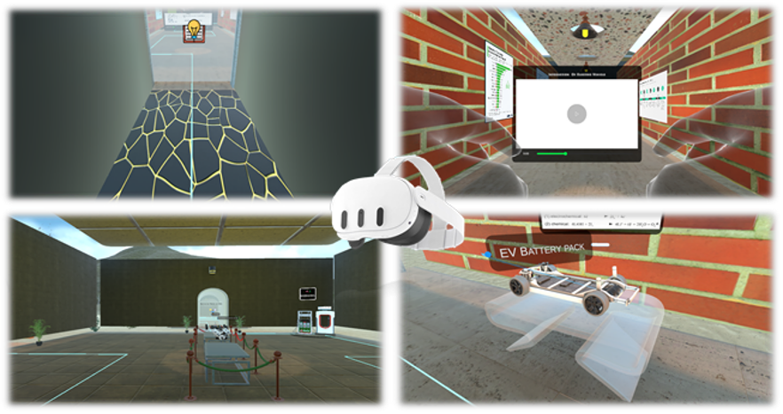
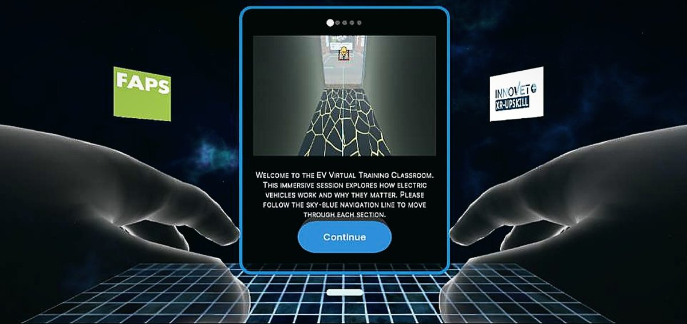
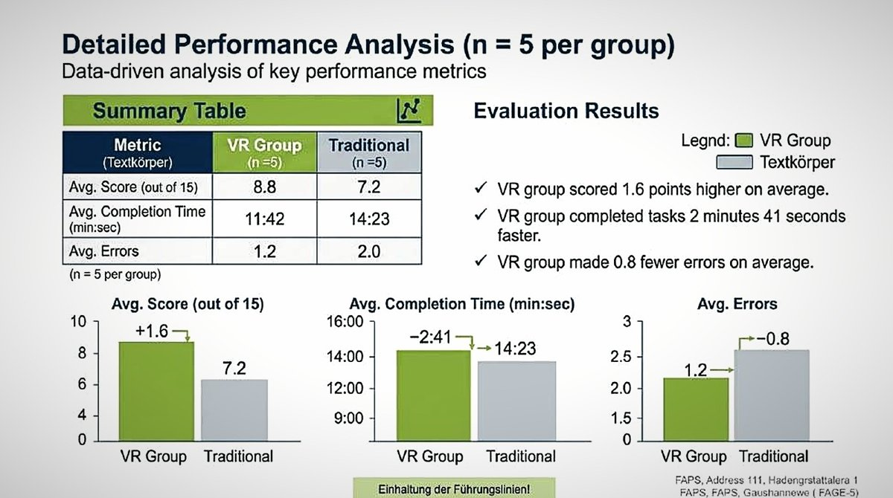

# 02 · Guided VR Learning Environment

**A self-paced virtual classroom for standalone Meta Quest 3. Learners walk through themed zones, watch narrated content on in-world screens and explore interactive 3D models at their own pace. Its effect was tested against learning from a document.**

Project thesis *"Integrating Immersive Technologies into Autodidactic Learning for Electromobility Practices"*, FAU Erlangen-Nürnberg, Chair FAPS (2025), within the XR-UpSkill collaboration.

`Unity 2022.3 (later upgraded to Unity 6)` · `URP` · `XR Interaction Toolkit` · `OpenXR` · `Meta Quest 3, standalone APK via SideQuest`

---

## ▸ HOW IT WORKS

- **Intro scene → main environment.** An onboarding board explains navigation and controls. *Start Session* then moves the same XR rig into the main environment and switches the skybox, with no further scene loading
- **Three learning zones**, each a separate room: the basics, a comparison area with animated 3D models (EV chassis, V8 engine), and a room for the key components
- **Teleportation and free movement**, guided by glowing floor lines and pulsing arrows, with fixed teleport points
- **Narrated video panels** in world space, plus 3D models the learner can grab and turn
- **Works seated or standing**; all interaction runs on the Quest controllers with haptic feedback
- **Fully offline**: no network or cloud services, so it runs anywhere
 

## ▸ PERFORMANCE ON STANDALONE QUEST

Everything runs on the headset itself, so the frame budget shaped every decision:

- Static objects are marked static, lighting is **baked** (Progressive GPU Lightmapper, Shadowmask) with low-resolution real-time lightmaps where needed
- One soft directional light; shadows only where they add something
- **Baked reflection probes** for each zone instead of real-time reflections
- Textures capped at 2K; heavy models simplified or replaced
- **Occlusion culling, static batching**, minimal post-processing, Vulkan
- LZ4 compression and removing unused assets kept the APK small enough to sideload and sped up loading
- Render scale is adjustable at runtime (`VRRenderScaleManager`)

Result in testing: steady frame rate with no visible stutter in normal use.

## ▸ USER STUDY

A small pilot comparison: **10 participants** (engineering students and vocational trainees). 5 learned with the VR environment, 5 with a PDF of the same content (about 20 minutes each), followed by the same 15-question test and a questionnaire.

- The VR group **scored higher on average**, especially on spatial and component questions (how parts are arranged and work together)
- The document group did slightly better on purely text-based facts
- VR learners reported more engagement; some wanted more control over the pace of narration, which went straight into the design of project 01 (play/pause/rewind on demand)

With 5 people per group this is an indication, not a statistical proof.
 

## ▸ SCRIPTS

| Script | What it does |
|---|---|
| `IntroTransition.cs` | Moves the XR rig from the intro zone into the main environment, swaps the active zones and the skybox |
| `SkyboxSwitcher.cs` | Switches between the intro and environment skyboxes |
| `GlowingNavigationLine.cs` | Builds an animated glowing floor path from a list of points with a LineRenderer |
| `GlowingArrow.cs` | Pulsing emissive direction arrows |
| `VRRenderScaleManager.cs` | Sets the XR eye-texture render scale for a performance/quality trade-off |
| `ExitApp.cs` | Ends the session in a build and stops play mode in the editor |

Most of this project's work is in scene design, content, lighting and optimisation rather than code. These scripts are the glue that holds the experience together.
