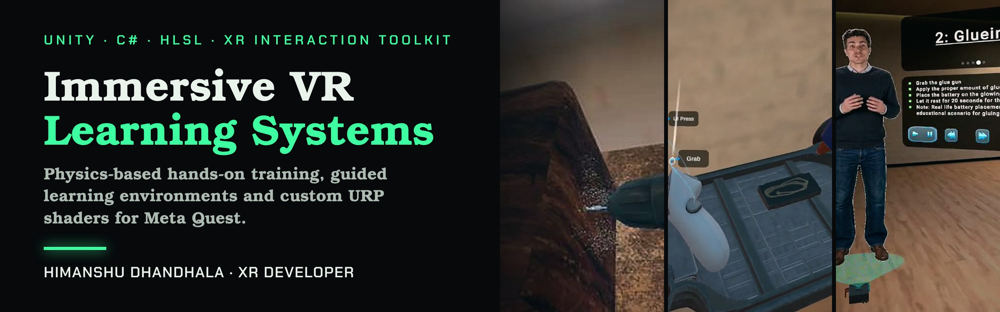

  
  
  
  
  

**Two VR learning systems I designed, built and evaluated in Unity: a physics-based hands-on training lab and a guided virtual learning environment.**

Both start from one human-centred idea: people learn practical skills best by doing them with their own hands. So instead of objects snapping into place, every interaction is driven by the learner's real movement, gives feedback the hands can feel, and explains mistakes instead of just rejecting them. The examples come from electromobility, but the design principles apply to any hands-on learning: assembly, maintenance, lab work or vocational education.

| Master's thesis: physics-based VR lab | Project thesis: VR learning environment |
|---|---|
|  |  |

---

## ▸ THE TWO PROJECTS

| | Project | What it shows | Context |
|---|---|---|---|
| **01** | [**Physics-Based VR Training Lab**](01-physics-based-vr-training-lab/) | Movement-driven interaction techniques (drilling, screwing, wire winding, gluing), multimodal feedback, error-explaining validation, a holographic virtual instructor and 12 custom HLSL shaders | Master's thesis, FAU Erlangen-Nürnberg (Chair FAPS), 2025–26 |
| **02** | [**Guided VR Learning Environment**](02-vr-learning-environment/) | A self-paced virtual classroom for standalone Meta Quest 3 and a between-subjects study comparing VR with document-based learning | Project thesis, FAU Erlangen-Nürnberg (Chair FAPS), 2025 |

Both were developed within the **XR-UpSkill** collaboration (FAU · FAPS · Robert Bosch GmbH · Virtual Dimension Center).

 

---

## ▸ HCI & INTERACTION DESIGN

The code follows a set of design principles. The full rationale, with the problem, the principle and the implementation for every interaction, is in **[Design & Research notes](docs/DESIGN_AND_RESEARCH.md)**.

| Principle | How it shows up |
|---|---|
| **Embodied interaction** | Progress comes from the learner's body: the drill bit's real penetration depth, wrist rotation around the screw axis, the hand circling the post. Nothing completes itself on a button press. |
| **Natural mapping & constraints** | Only rotation around the hole axis turns a screw (turns × pitch = depth); a screw only seats when aligned; a hole can only be drilled on valid surfaces. Wrong actions are physically impossible rather than forbidden by a message. |
| **Multimodal feedback** | Haptics scale with drill depth, twist speed and reel speed; audio changes between drilling in air and in wood; visual state changes as glue dries. |
| **Error tolerance** | A ratchet ignores small backward twists when the learner re-grips; start and release thresholds filter accidental winding movements. |
| **Explaining errors** | The placement grid separates *missing glue* from *wrong orientation*, so learners know what to fix instead of only seeing "wrong". |
| **Learner control** | Instructions and the holographic instructor appear on demand when the learner enters a station; play/pause, forward/back and *Mark as Done* stay with the learner. This came directly from the project thesis study. |
| **Spatial guidance** | A floor path leads to the next station and fades finished sections, so orientation doesn't need menus. |
| **Iterative, evidence-led design** | Project thesis study → findings → redesign in the Master's thesis. |

## ▸ RESEARCH DIRECTIONS

Questions this work opens up, and that I want to study further:

- **Presence and trust of virtual humans:** how do spatial placement, gaze, voice and visual fidelity change how much learners trust and follow a virtual instructor?
- **Physical realism vs. learning:** does movement-driven interaction improve procedural learning and transfer to the real task compared with snap-based interaction?
- **Haptic feedback design:** which feedback patterns support skill acquisition and which add cognitive load?
- **Adaptive guidance:** when should a guide step in, and when should it hold back to support autonomy?

The notes also include an [evaluation plan](docs/DESIGN_AND_RESEARCH.md#evaluation-plan) with standard measures for these questions.

---

## ▸ WHAT YOU'LL FIND IN THE CODE

- **Custom simulation where Unity has nothing built in:** a Verlet rope with helix capture for winding, procedural glue-bead meshes that thicken where you linger and dry over time, and a reel with inertia and friction.
- **Study-ready prototypes:** every behaviour is parameterised (thresholds, feedback strength, timing) in the Inspector, so conditions can be varied for experiments.
- **Shaders written for VR:** URP HLSL shaders with single-pass stereo support for drill holes, drying glue, hologram projection, chroma keying, floor guides and UI.
- **Editor tooling:** build loggers and scanners that track down Android/Quest build failures.

## ▸ TECH

`Unity 6` · `C#` · `HLSL` · `Shader Graph` · `URP` · `XR Interaction Toolkit 3` · `OpenXR` · `XR Hands` · `Meta Quest 3` · `Blender`

## ▸ NOTES

- **Scripts and shaders only.** This isn't a full Unity project. 3D models and textures come from licensed sources (Unity Asset Store, Sketchfab, Poliigon) and can't be redistributed.
- 📄 [Project portfolio (PDF)](docs/Himanshu_Dhandhala_XR_Portfolio.pdf) · 🧠 [Design & Research notes](docs/DESIGN_AND_RESEARCH.md)

---

**Himanshu Dhandhala**, XR Developer
[LinkedIn](https://www.linkedin.com/in/himanshu-dhandhala-640a36398/) · dhandhalahim02@gmail.com
