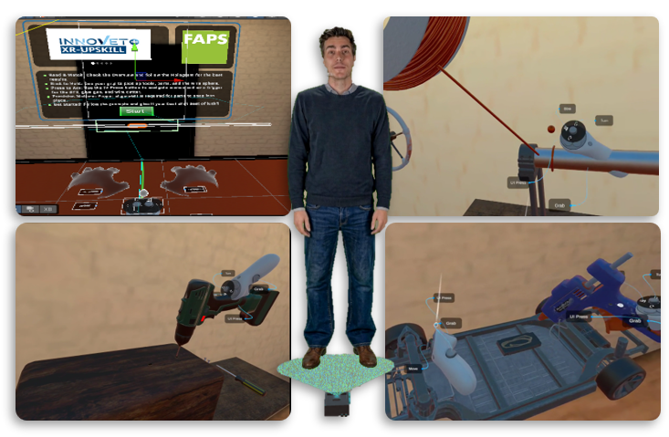
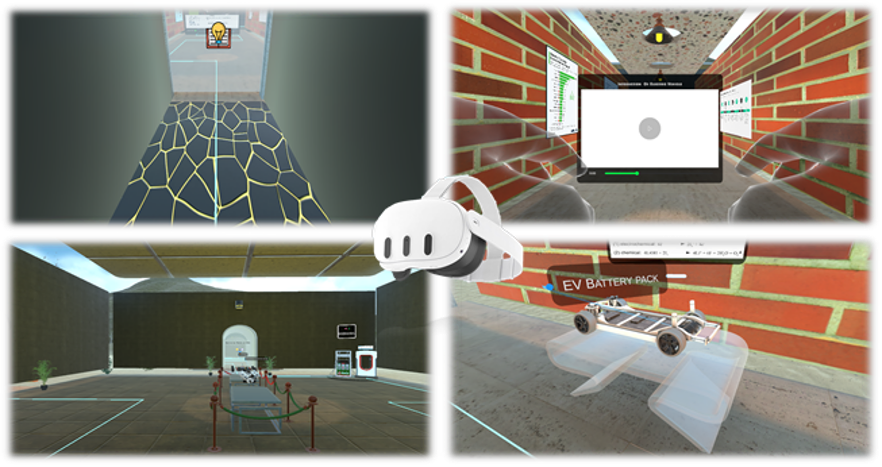

  
  
  
  

**Source code from two VR learning applications I built in Unity: a physics-based hands-on training lab and a guided virtual learning environment.**

The idea behind both projects is the same: people learn practical skills best by doing them, so a VR training app should let them practise real procedures with immediate feedback. The examples come from electromobility, but the techniques work for any hands-on training: assembly, maintenance, lab work or vocational education.

---

## ▸ THE TWO PROJECTS

| | Project | What it shows | Context |
|---|---|---|---|
| **01** | [**Physics-Based VR Training Lab**](01-physics-based-vr-training-lab/) | Drilling, screwing, wire winding and gluing driven by the learner's real movements, a holographic instructor, step validation, haptics and 12 custom HLSL shaders | Master's thesis, FAU Erlangen-Nürnberg (Chair FAPS), 2025–26 |
| **02** | [**Guided VR Learning Environment**](02-vr-learning-environment/) | A self-paced virtual classroom with themed zones, narrated video panels, teleport navigation, standalone Quest performance tuning and a user study against document-based learning | Project thesis, FAU Erlangen-Nürnberg (Chair FAPS), 2025 |

Both were developed within the **XR-UpSkill** collaboration (FAU · FAPS · Robert Bosch GmbH · Virtual Dimension Center).

 

---

## ▸ WHAT YOU'LL FIND IN THE CODE

- **Interaction by real movement, not snapping.** The hole deepens as the drill physically enters the material, a screw only advances when the screwdriver is twisted around the hole axis, and the wire coils around a post as the learner's hand orbits it.
- **Custom simulation where Unity has nothing built in.** A Verlet rope with a helix capture for winding, procedural glue-bead meshes that thicken where you linger and dry over time, and a reel with inertia and friction.
- **Steps that have to be done right.** A screw can't go in before the hole is fully drilled, and a battery cell is only accepted with enough glue and the glued side facing down. The placement grid shows *missing glue* and *wrong orientation* as separate states, so learners know exactly what to fix.
- **Guidance that doesn't take over.** Zone-triggered instruction panels, a holographic presenter on demand, a floor path that updates as you progress, and a start/end session flow.
- **Shaders written for standalone VR.** URP HLSL shaders with single-pass stereo support for drill holes, drying glue, hologram projection, chroma keying, floor guides and UI.
- **Editor tooling.** Build loggers and scanners that track down Android/Quest build failures.

## ▸ TECH

`Unity 6` · `C#` · `HLSL` · `Shader Graph` · `URP` · `XR Interaction Toolkit 3` · `OpenXR` · `XR Hands` · `Meta Quest 3` · `Blender`

## ▸ NOTES

- **Scripts and shaders only.** This isn't a full Unity project. 3D models and textures come from licensed sources (Unity Asset Store, Sketchfab, Poliigon) and can't be redistributed.
- 📄 [Project portfolio (PDF)](docs/Himanshu_Dhandhala_XR_Portfolio.pdf)

---

**Himanshu Dhandhala**, XR Developer
[LinkedIn](https://www.linkedin.com/in/himanshu-dhandhala-640a36398/) · dhandhalahim02@gmail.com
